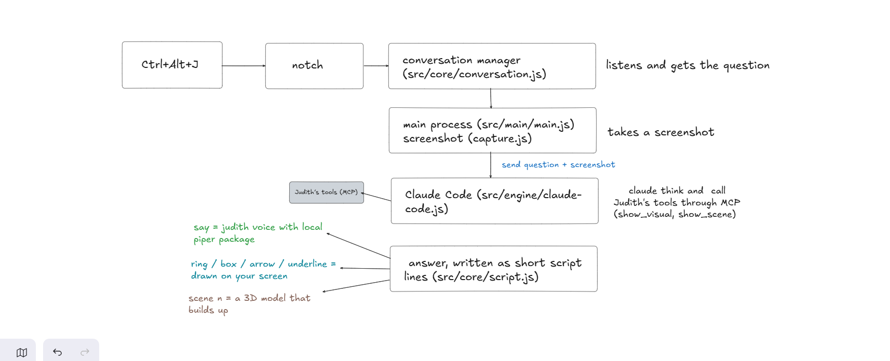
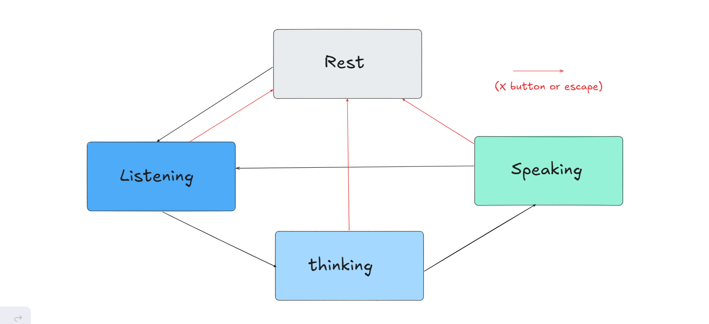

# How Judith is built

## From a question to an answer

- One part, `conversation.js`, decides who talks and when. Everything else just reports to it.
- Claude Code stays running between questions (a new one each time takes about 10 s).
- Claude answers in short script lines. Judith reads them as they stream in, so a drawing appears when she starts the sentence about it.
- Drawings follow the page when it scrolls and disappear when the content changes.
- A small Windows helper finds the real button under a drawing, so a ring lands on it.

## Who talks when

- Every question has a number. Anything a cancelled question still sends is ignored.
- The X button or Escape stops everything, from any state.

## MCP

- Judith has her own small MCP server (`src/mcp/server.js`). Claude Code starts it, nothing to set up.
- Three tools: `look_at_screen`, `show_visual`, `show_scene`.
- It talks to the app through a local bridge: `127.0.0.1` only, with a random token on each call.

## Safety

- Pages are sandboxed, with no Node in them.
- Code written by the model (3D, diagrams) runs in a frame with no network.
- Screenshots are never saved to disk.
- Autonomous mode: forbidden apps, confirmation before deleting, sending or paying, no passwords typed, stops when you move the mouse.
- "Claude can act" is on by default and runs Claude Code without permission prompts. Text on a screen can try to give it orders. You can turn it off in the settings.

## Tests

- 165 unit tests (`npm test`), no Electron needed.
- A test fails if a sentence has no English version.

## Weak points

- Windows only, and it needs Claude Code.
- The installer is not signed.
- Answers take 1.5 to 14 seconds, mostly the model.
- Drawing precision depends on the model.
- `main.js` is too big and needs to be split.
